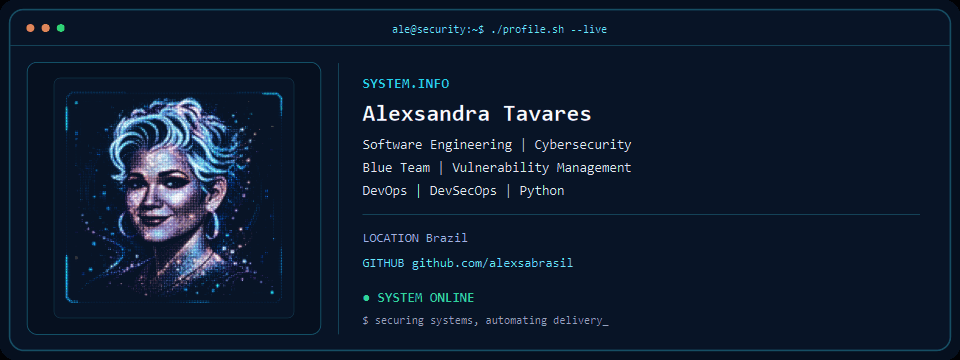

<!-- PERFIL GITHUB BILÍNGUE — VERSÃO 3.6 -->
<!-- Recursos visuais: Terminal Banner V6.3 e Cyber City V1.2. -->
<!-- Antes de publicar: confirmar navegação bilíngue e caminhos dos arquivos visuais. -->

[🇺🇸 English](README.md) | **🇧🇷 Português**

### Engenharia de Software • Cibersegurança • DevOps / DevSecOps

**Blue Team · Gestão de Vulnerabilidades · CI/CD · Automação · Observabilidade**

---

## Sobre mim

Sou estudante de **Engenharia de Software** e **Segurança da Informação**, com formação prática em **Blue Team e Gestão de Vulnerabilidades** e desenvolvimento de projetos em **DevOps e DevSecOps**. Tenho interesse em construir e proteger sistemas por meio de automação, monitoramento, testes e melhoria contínua.

Minha trajetória também inclui formação e atuação em **Educação**, experiência que fortalece minha comunicação, documentação técnica e colaboração em equipes multidisciplinares.

## Experiência prática em Cibersegurança

### Residência em Cibersegurança — Hackers do Bem / RNP

Atuação prática com **gestão de vulnerabilidades**, incluindo descoberta e avaliação de ativos, análise e classificação de achados, acompanhamento de correções e documentação de resultados.

- **Avaliação e priorização:** OpenVAS/Greenbone, referências CVE/CVSS e DefectDojo.
- **Monitoramento e análise:** Wazuh e Graylog.
- **Automação e administração:** Ansible, WSUS e ambientes Linux/Windows.

> Meu foco é conectar a identificação de vulnerabilidades a processos de tratamento, rastreabilidade e redução de riscos.

### Pesquisa independente e segurança de aplicações

Atuação como **pesquisadora independente de vulnerabilidades**, com estudos e testes em programas autorizados de pesquisa de segurança, respeitando os escopos e as políticas de divulgação responsável.

- **Segurança de aplicações:** estudos e laboratórios com Burp Suite.
- **Segurança de endpoints:** aprofundamento em soluções Trend Micro, com projetos práticos em desenvolvimento.
- **Pesquisa responsável:** investigação, documentação técnica e desenvolvimento contínuo de metodologias de análise de vulnerabilidades.

## Projetos em destaque

Uma seleção de projetos que reúne **segurança, engenharia de software, automação, infraestrutura e observabilidade**.

| Projeto | Problema ou competência demonstrada | Tecnologias e práticas |
| --- | --- | --- |
| **[Dashboard de Vulnerabilidades](https://github.com/alexsabrasil/dashboard-vulnerabilidades)** | Organização e visualização de informações para apoiar o acompanhamento de vulnerabilidades. | Gestão de vulnerabilidades, dashboards, métricas |
| **[DevSecOps Commander Center](https://github.com/alexsabrasil/DevSeCops-Commander-Center)** | Apresentação visual de práticas e decisões de segurança integradas ao desenvolvimento. | DevSecOps, visualização, segurança de pipelines |
| **[CI/CD Pipeline Rescue](https://github.com/alexsabrasil/cicd-pipeline-rescue)** | Recuperação e melhoria de pipeline com validações automatizadas e critérios de qualidade. | CI/CD, testes, *fail fast*, quality gates, Docker |
| **[Desafio Kubernetes](https://github.com/alexsabrasil/desafio-kubernetes)** | Implantação de aplicações e banco de dados em ambiente de orquestração. | Kubernetes, Minikube, Docker, Node.js, PostgreSQL |
| **[API-Lab](https://github.com/alexsabrasil/api-lab)** | Desenvolvimento de API com testes, métricas e práticas de integração contínua. | Node.js, Express, testes, observabilidade |

### Outros projetos e laboratórios

Projetos anteriores que documentam minha evolução técnica e aprofundam competências complementares:

- **[DevOps & Observabilidade](https://github.com/alexsabrasil/desafio-devops-observabilidade):** monitoramento de aplicação e métricas com Prometheus e Grafana.
- **[Delivery API Automation](https://github.com/alexsabrasil/delivery-api-automation):** automação de verificações de qualidade e segurança em pipeline.
- **[Nexus NPM Proxy Lab](https://github.com/alexsabrasil/nexus-npm-proxy-lab):** gerenciamento e cache de dependências com Nexus Repository.

## Competências técnicas

**`SECURITY.TOOLKIT` — Tecnologias em destaque**

| Especialidade | Ferramentas e conhecimentos praticados |
| --- | --- |
| **Blue Team e Gestão de Vulnerabilidades** | OpenVAS/Greenbone, DefectDojo, Wazuh, Graylog, CVE/CVSS, Ansible, WSUS |
| **Segurança de aplicações** | Fundamentos OWASP, Burp Suite, Nmap, Wireshark, análise de vulnerabilidades |
| **DevOps e DevSecOps** | Git, GitHub Actions, GitLab CI/CD, Jenkins, SAST, testes automatizados, quality gates |
| **Containers e infraestrutura** | Docker, Docker Compose, Kubernetes, Minikube, Terraform, LocalStack |
| **Observabilidade** | Prometheus, Grafana, métricas e logs |
| **Desenvolvimento e automação** | Python, JavaScript/Node.js, SQL, Linux, APIs REST |

## CTFs e desafios de segurança

Participação em desafios práticos de cibersegurança, com foco em investigação, análise de evidências, resolução de problemas e desenvolvimento de habilidades técnicas.

- **Cyber Academy FEBRABAN 2026 — CTF #3:** participação concluída.
- **Hackers do Bem / RNP:** atividades práticas e desafios de segurança durante a formação.
- **WOMCY CTF 2026:** participação nas etapas de preparação e capacitação; competição programada.
- **CTF Feminino:** atividades de preparação e desenvolvimento de habilidades para competições.

> Os registros de participação e os write-ups serão adicionados conforme a disponibilidade de evidências públicas, respeitando as regras de cada competição.

## Plataformas de treinamento e pesquisa

- **[Bugcrowd](https://www.bugcrowd.com/)** — pesquisa independente de vulnerabilidades, com foco em testes autorizados e divulgação responsável.
- **PortSwigger Web Security Academy** — referência de aprendizado em segurança de aplicações web e uso do Burp Suite.

## Formação e comunidade

### Formação acadêmica

- **Engenharia de Software** e **Segurança da Informação** — UniFatecie, graduações em andamento.
- **Pedagogia e Psicopedagogia** — formação anterior, com experiência em educação e aprendizagem.

### Formação técnica

- **Residência em Cibersegurança — Hackers do Bem / RNP** — concluída, com foco em Gestão de Vulnerabilidades.
- **CISSA Journey (2026)** — capacitação e desenvolvimento em segurança cibernética.
- **Pentest Mobile Android — OVER Security (2026)** — estudos de segurança Android, engenharia reversa, Android Studio, ADB e Burp Suite.
- **Formação prática em DevOps — FAP** — pipelines, containers, infraestrutura como código e observabilidade.

### Comunidades e iniciativas

**WOMCY Brasil — CyberEdu Member**

Membro CyberEdu da WOMCY Brasil, comunidade voltada ao desenvolvimento, à capacitação e à participação de mulheres na cibersegurança.

- **Embaixadores Estudantis Google 2026** — participação em atividades de aprendizagem, comunicação e uso responsável de IA.
- **Comunidades e eventos de tecnologia** — colaboração, troca de conhecimentos e desenvolvimento profissional.

## Minha jornada de contribuições | GitHub Activity

**`GITHUB.ACTIVITY` — Cyber City — Live Contribution Network**

O calendário tridimensional apresenta minha atividade no GitHub ao longo do tempo. Cada bloco representa um dia, e sua altura indica a intensidade relativa das contribuições.

Os edifícios representam dias com contribuições registradas no GitHub. Sua altura acompanha a intensidade da atividade, enquanto os fluxos luminosos simbolizam, de forma artística, a continuidade do aprendizado e da evolução técnica.

*Mais do que uma sequência de commits, esta visualização acompanha uma jornada de estudos, experimentação e desenvolvimento contínuo.*

---

## Uso do conteúdo

O conteúdo original deste perfil, incluindo sua estrutura, textos e elementos de apresentação, é de autoria de **Alexsandra Tavares**.

A reutilização, adaptação ou reprodução deste conteúdo para outros projetos, perfis ou publicações requer autorização prévia da autora.

© 2026 Alexsandra Tavares. Todos os direitos reservados.
